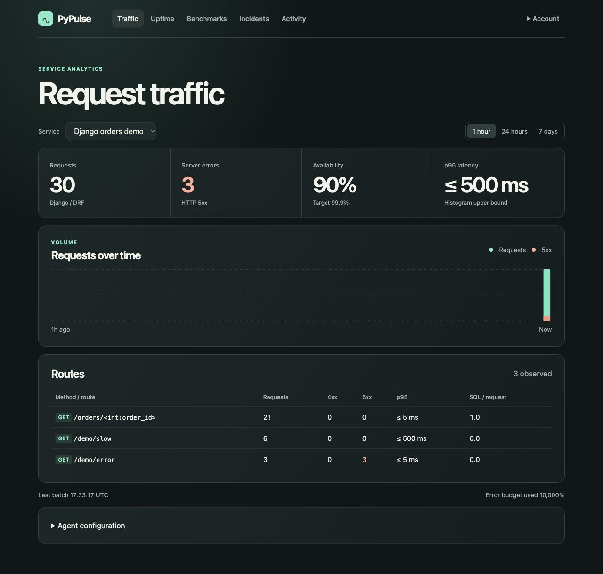
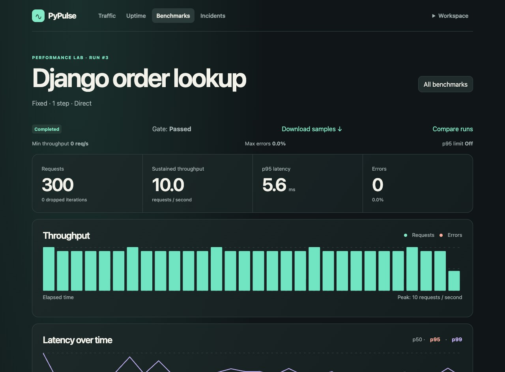
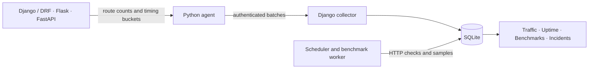

# PyPulse

**See which Python routes are slow, which ones fail, and how many queries each Django request costs.** PyPulse is a self-hosted Django application with a Python collector, scheduler and HTTP benchmark worker. The dashboard renders on the server and refreshes live reports in the browser.

[Explore the product site ↗](https://shivamrohilllaa.github.io/PyPulse/) · [Start here](#start-the-dashboard) · [Choose your framework](#connect-your-framework) · [Try the Django experiment](#try-the-django-experiment) · [Dashboard guide](docs/dashboard-guide.md)

[](docs/screenshots/traffic.jpg)

## Start the dashboard

<details open>
<summary><strong>Docker Compose</strong></summary>

```sh
git clone https://github.com/ShivamRohilllaa/PyPulse.git
cd PyPulse
docker compose up -d --build
docker compose exec web python manage.py createsuperuser
```

Open **http://localhost:8080** and sign in. **Connect service** creates a token for one Python application. Compose starts the web process and a separate worker for uptime checks and benchmarks. The named volume stores SQLite and the Django signing key.

</details>
<details>
<summary><strong>Python on your machine</strong></summary>

Use Python 3.11 or later for the dashboard. From the repository root:

```sh
python3 -m venv .venv
. .venv/bin/activate
python -m pip install -r requirements.txt
python manage.py migrate
python manage.py collectstatic --noinput
python manage.py createsuperuser
python manage.py runserver 127.0.0.1:8080 --noreload
```

In a second terminal, run `.venv/bin/python manage.py pulseworker`. For a deployed instance, use the supplied Gunicorn entry point behind an HTTPS proxy. [Deployment settings](docs/dashboard-guide.md#deploy-and-back-up)

</details>

## Connect your framework

In the app's own Python environment, install the agent from the cloned **python/** folder. Give each service its own token. Set the worker environment before restarting your app.

```sh
python -m pip install ./python
export PYPULSE_URL=http://127.0.0.1:8080
export PYPULSE_TOKEN='your-service-ingest-token'
```

For apps on another host, use the reachable HTTPS base URL. On the Compose network the internal address is `http://web:8080`.

<details>
<summary><strong>Django</strong> · add one middleware to settings</summary>

Place this after your existing `MIDDLEWARE` definition in the active settings module and restart your WSGI or ASGI workers.

```python
MIDDLEWARE = ["pypulse_agent.django.middleware", *MIDDLEWARE]
```

Request a URL such as `/orders/42` and open **Traffic**. Different IDs share one route template. Synchronous Django also reports SQL executions per request. [Sample settings](examples/python/django_settings.py)

</details>
<details>
<summary><strong>Django REST Framework</strong> · instrument API views and viewsets</summary>

Prepend the same Django middleware once. Your APIViews, serializers and routers can stay as they are. For the bundled example, run the following from the repository root after setting the token.

```sh
python -m pip install './python[test]'
DJANGO_SETTINGS_MODULE=examples.python.django_settings python -m django runserver 127.0.0.1:8000 --noreload
```

Visit `http://127.0.0.1:8000/orders/42`. [DRF views and routes](examples/python/django_urls.py)

</details>
<details>
<summary><strong>Flask</strong> · instrument your app factory</summary>

```python
from flask import Flask
from pypulse_agent.flask import instrument

def create_app():
    app = Flask(__name__)
    instrument(app)
    # Register your routes or blueprints here.
    return app
```

For a file-level Flask app, call `instrument(app)` once after creating it. Start the included sample with `python -m flask --app examples.python.flask_app run --port 8000` and request `/orders/42`. [Flask example](examples/python/flask_app.py)

</details>
<details>
<summary><strong>FastAPI</strong> · register ASGI timing</summary>

```python
from fastapi import FastAPI
from pypulse_agent.fastapi import PulseMiddleware

app = FastAPI()
app.add_middleware(PulseMiddleware)
```

Start the sample with `python -m uvicorn examples.python.fastapi_app:app --port 8000` and request `/orders/42`. Timing includes the final HTTP response body. [FastAPI example](examples/python/fastapi_app.py)

</details>

## Try the Django experiment

Run the DRF example above. Open **Traffic**, select the service, and choose **1 hour**. From a second terminal:

```sh
python examples/python/django_traffic.py
```

<details>
<summary><strong>Predict the result, then open the expected route breakdown</strong></summary>

| Route | Requests | Result |
| --- | ---: | --- |
| `/orders/<int:order_id>` | 21 | HTTP 200 and one SQL query per request |
| `/demo/slow` | 6 | HTTP 200 after a deliberate 320 ms delay |
| `/demo/error` | 3 | Intentional HTTP 500 |

A fresh service should show **30 requests, 3 server errors and 90% availability** after the next export and refresh. A p95 reading of **≤500 ms** is the upper edge of a histogram bucket. Try one more call to the error route and watch the row change.

</details>

<details>
<summary><strong>Open the real benchmark report</strong> · 300 HTTP 200 responses</summary>

In a separate local Django run, the Python worker sent 10 requests/s for 30 seconds. All 300 succeeded. Measured p95 was 8.62 ms and p99 was 25.65 ms. Try the same workload from **Benchmarks** to get numbers for your own machine.

[](docs/screenshots/benchmark.jpg)

</details>

## Inside PyPulse



| Open | Use it for |
| --- | --- |
| Traffic | Route p95, SQL per request, 4xx/5xx, availability, error budget and a volume chart |
| Uptime | Scheduled HTTP checks, response assertions and slow or failed endpoints |
| Benchmarks | Fixed, ramp, spike, soak, stress and latency runs, thresholds, schedules, comparisons and CSV samples |
| Incidents | Open, acknowledge and follow failures through recovery |
| Activity | Review workspace operations and CI launches |
| Administration | Users, permissions, maintenance windows and saved configurations |

[Feature walkthrough](docs/dashboard-guide.md) · [Agent internals](python/README.md) · [MIT license](LICENSE)
